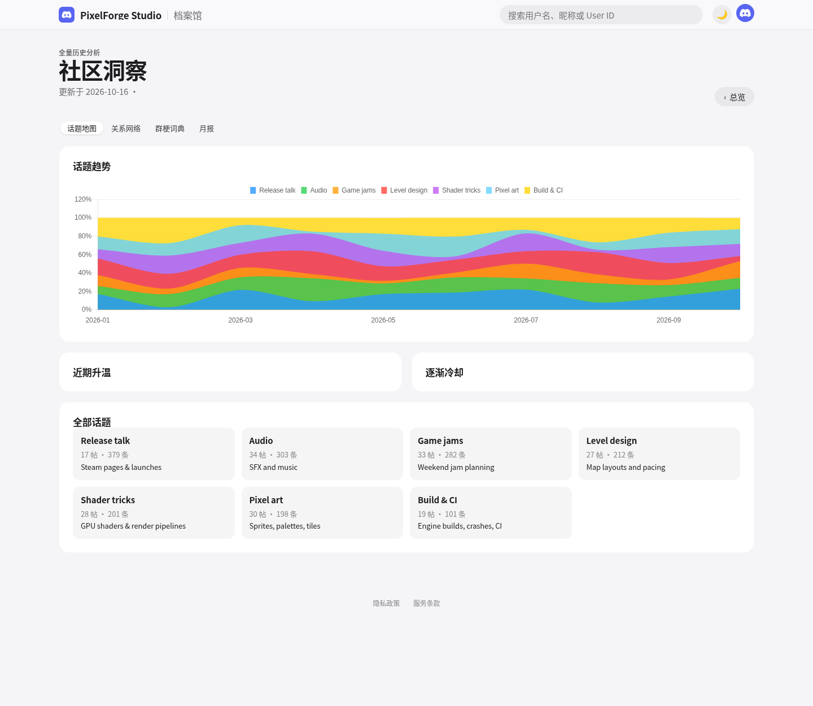
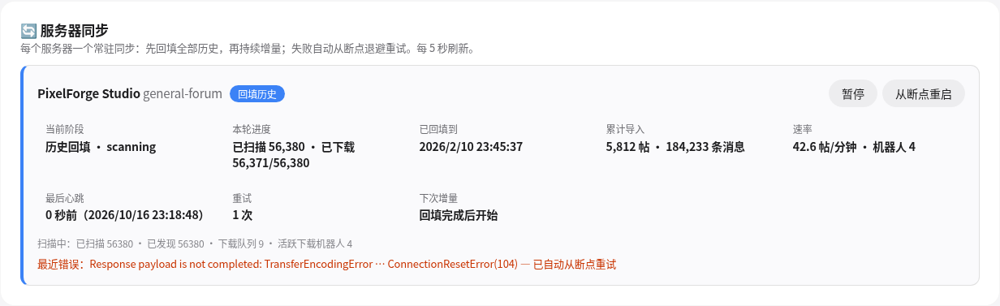
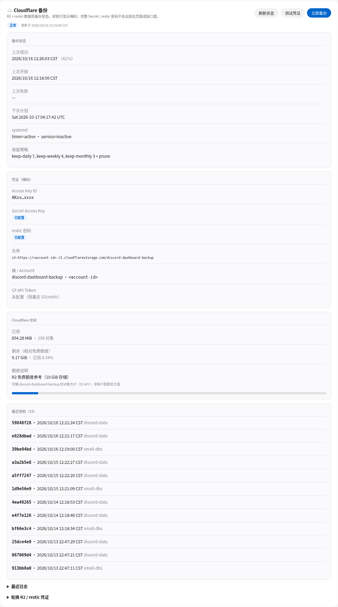
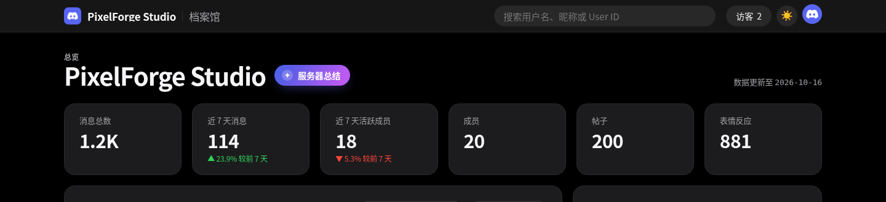
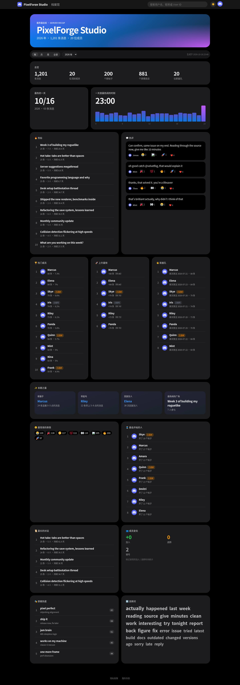
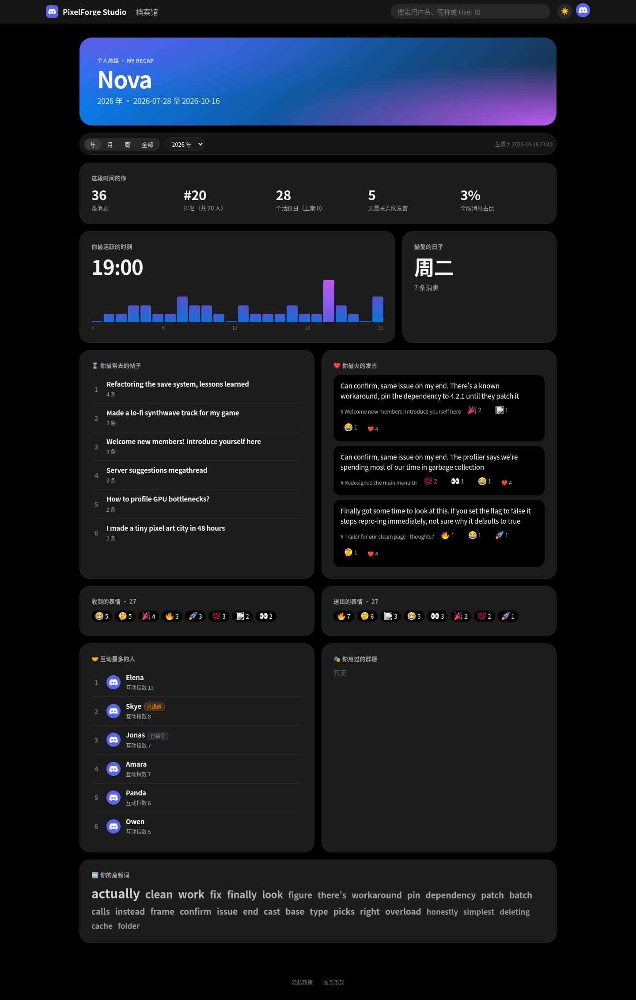
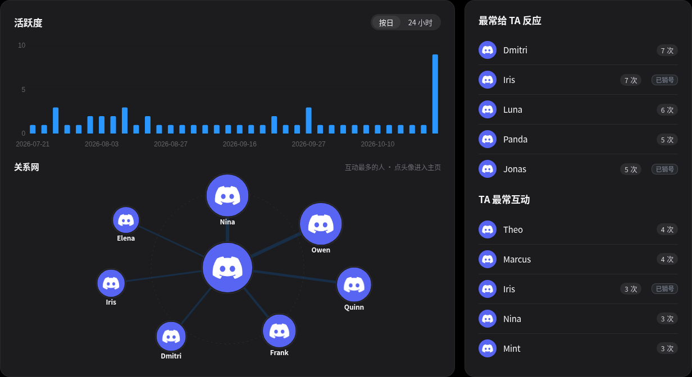

# Dixo — Discord Forum Analytics

> Discord 论坛数据分析、成员活跃分层与下载管理平台
> Analytics, member-activity tiers and archive downloads for Discord **Forum** channels.

🔗 **在线演示 / Live Demo：** [https://discordanalytics.monster6324.me/](https://discordanalytics.monster6324.me/)

🤖 **添加机器人 / Add Bot：** [邀请 Dixo Bot / Invite Dixo Bot](https://discord.com/oauth2/authorize?client_id=1460293619616317607)

<p align="center">
  
  
</p>

---

## 目录 / Contents

- [简介 / Overview](#简介--overview)
- [功能 / Features](#功能--features)
- [截图 / Screenshots](#截图--screenshots)
- [快速开始 / Quick Start](#快速开始--quick-start)
- [生产部署 / Deployment](#生产部署--deployment)
- [配置 / Configuration](#配置--configuration)
- [AI 只读 API / AI API](#ai-只读-api--ai-api)
- [项目结构 / Project Layout](#项目结构--project-layout)
- [鸣谢 / Credits](#鸣谢与依赖引用--credits--attribution)
- [打赏 / Donation](#打赏支持--donation)

---

## 简介 / Overview

**中文：** Dixo 把 Discord 论坛频道的帖子、回复与表情反应持续采集进 SQLite，并以苹果风格的浅色 / 深色仪表盘呈现：趋势、热力图、词云、排行榜、成员主页，以及按月判定的成员活跃分层。它既能在浏览器里使用，也能作为 **Discord Activity** 直接在 Discord 客户端（含手机）内打开。

**English:** Dixo continuously ingests Discord Forum threads, replies and reactions into SQLite and presents them as an Apple-style light/dark dashboard — trends, heatmaps, word clouds, leaderboards, member profiles and monthly member-activity tiers. Use it in the browser or open it inside the Discord client (desktop & mobile) as a **Discord Activity**.

---

## 功能 / Features

| | 中文 | English |
| --- | --- | --- |
| 📈 **数据分析** | 消息 / 活跃成员 / 新帖 / 回复率，按日·周·月·年，30 天 / 90 天 / 1 年 / 全部 / 自定义区间；星期×小时热力图、表情排行、jieba 中文词云（含停用词） | Messages, active members, new threads and reply rate by day/week/month/year with 30d/90d/1Y/all/custom ranges; weekday×hour heatmap, emoji ranking, jieba-based Chinese word cloud with stopwords |
| 🧭 **成员活跃分层** | 一贯活跃 / 消失后回归 / 活跃后消失 / 几乎不活跃 / 近两月新活跃；按「最后一次发言」计算沉默月数，全历史月度堆叠图 + 分页全员名单（按消息数排序），用于留存盘点与清理 | Always active / returned / faded / rare / new, measured from the *last* message; full-history monthly stacked chart and paginated member lists (sorted by message count) for retention reviews and cleanup |
| 👤 **成员主页** | 发言、获赞、送出反应、发帖、活跃天数，发帖/发言记录（最新·最热），互动对象、个人词云；首屏走汇总表，重内容异步加载 | Messages, reactions received/given, threads, active days; thread/message history (newest·hottest), interaction partners and personal word cloud; summary-table first paint, heavy parts filled async |
| ⭐ **收藏 / 拉黑** | 收藏帖子、拉黑成员，在主页分页管理 | Favourite threads and block members, managed with pagination on the profile |
| 🔄 **服务器统一同步** | 每个服务器一条常驻同步：自动回填全部历史（断点续扫）→ 转入持续增量；实时消息由网关写入。任何失败（网络重置、截断响应、崩溃、重启）都会从断点按指数退避自动重试，永不停止；只有连续失败超过 30 分钟或回填完成时才通知。多 Bot 并行导出（DiscordChatExporter），未变化帖子自动跳过 | One continuous sync per guild: automatic full-history backfill (checkpointed), then ongoing incremental sync; live messages come from the gateway. Any failure auto-retries from checkpoint with exponential backoff, forever; notifications only after 30 min of persistent failure or when backfill completes |
| 🤖 **AI 只读 API** | Bearer Token 保护的 `/api/ai/v1`：成员、消息、帖子、全文搜索，以及**单个成员发言历史的 Markdown 导出**，方便喂给 LLM 做人设/总结 | Bearer-token `/api/ai/v1`: members, messages, threads, full-text search and **per-member Markdown export** of message history for LLM personas/summaries |
| 🌗 **浅色 / 深色** | 一键切换并记忆；中英双语界面；统一紧凑数字（1.2K、5M、1B） | One-tap theme toggle (remembered), zh/en UI, compact numbers (1.2K, 5M, 1B) |
| 📱 **Discord Activity** | Embedded App SDK 自动登录；手机端安全区适配、点击区域修正、服务器选择服务端记忆 | Embedded App SDK auto-login; mobile safe-area insets, fixed tap targets, server choice remembered server-side |
| ⚡ **性能** | 增量 `summary.db`（影子重建 + 原子替换，重建期间显示上次正确值）、水位缓存、精简索引；百万级消息首页亚秒级 | Incremental `summary.db` (shadow rebuild + atomic swap, last-good KPIs during rebuilds), watermark caches, lean indexes; sub-second home page on millions of messages |
| 🛡️ **管理后台** | 白名单与配额、下载 Bot、服务器配置、下载任务、成员同步、账号合并 | Whitelist & quotas, download bots, server configs, tasks, member sync, account merges |
| ✨ **服务器总结** | 首页标题旁的动效按钮 → 年 / 月 / 周 / 全部总结：热帖、热评、热门 / 上升 / 新成员、总量与环比、最热的一天和时段、表情、群梗与高频词、开帖达人、最长对话、成员变动、本期之最。后台生成并缓存 | Animated button next to the server title opens a Year / Month / Week / All-time recap (hot threads & messages, top/rising/new members, totals vs previous period, peak day/hour, emojis, memes & words, starters, longest threads, member changes, superlatives); built in the background and cached |
| 🪞 **个人总结** | 同样的周期选择：消息数与排名、活跃天数、最长连续发言、活跃时段、常去帖子、最火发言、收到 / 送出的表情、互动最多的人、高频词与群梗、与上期对比 | Same period picker for your own recap: messages & rank, active days, streak, peak hours, top threads, hottest messages, reactions received/given, closest partners, words/memes, change vs previous period |
| 🫧 **个人关系网** | 个人主页「活跃度」卡片下方：以本人为中心的气泡图，只画 TA 和互动最多的人，可点击跳转，黑名单成员不显示 | Ego-network bubble chart on the profile activity card (only the person and their top partners, clickable, blacklist hidden) |
| 👥 **成员状态** | 首页环形图 + 排行/成员页徽章：在群 / 已退群 / 已销号（网关 join/leave 实时更新，定期全量校准） | Home donut and badges: in guild / left / deleted, kept live from gateway join/leave events |
| 📊 **发言集中度** | Top 1 / Top 10 / Top 100 / 其余成员的消息占比环形图 | Donut of message share for top 1 / 10 / 100 vs everyone else |
| 🚫 **全局黑名单** | 一级管理员维护；黑名单成员在所有页面、统计、洞察与 AI/MCP 接口中隐藏 | Level-1 admins maintain a global blacklist hidden from every page, stat, insight and API |
| ☁️ **Cloudflare R2 备份** | 后台查看 restic → R2 备份状态、快照、日志与已用/剩余空间；可测试凭证、立即备份、轮换密钥（只显示掩码） | Admin card for restic→R2 backups: status, snapshots, logs, space used/left; test creds, run now, rotate keys (masked only) |

---

## 截图 / Screenshots

> 截图来自内置的假数据演示库（`generate_fake_data.py`），非真实社区数据。
> Screenshots use the bundled fake demo database, not real community data.

| | 浅色 Light | 深色 Dark |
| --- | --- | --- |
| 首页 Home |  |  |
| 深度分析 Analytics |  |  |
| 成员主页 Profile |  |  |

| 社区洞察 Insights | 后台 · 服务器同步 Admin guild sync |
| --- | --- |
|  |  |

<p align="center"></p>

**v1.4 · 服务器总结 / 个人总结 / 个人关系网（深色）**



| 服务器总结 Server recap（年） | 个人总结 My recap |
| --- | --- |
|  |  |




> 首页（浅色）已更新为 v1.3：活跃趋势下方新增「成员状态」与「发言集中度」两张环形图。后台截图中的密钥、账号 ID 均已打码。
> The light home screenshot shows v1.3's member-status and message-concentration donuts. Keys and account IDs in admin screenshots are masked.

<p align="center">
  
  
  
  
  
</p>

---

## 快速开始 / Quick Start

```bash
python -m venv venv
venv/bin/pip install -r requirements.txt
cp .env.example .env              # 填入 Discord 应用 / Bot 凭据 · fill in Discord app/bot credentials
venv/bin/python generate_fake_data.py   # 可选：生成演示数据 · optional demo data
venv/bin/python app.py
```

- 下载器与机器人由 `app.py` 自动拉起；单独调试可运行 `Preparation_Before_Use/discord_downloader.py` / `whitelist_bot.py`。
  The downloader and bot are started by `app.py`; run them standalone from `Preparation_Before_Use/` for debugging.
- 下载功能需要自行下载 **DiscordChatExporter**（见鸣谢）。Downloads require **DiscordChatExporter** (see Credits).
- 测试 / Tests: `venv/bin/python -m pytest -q`（浏览器点击回归 `tests/e2e/` 需 `playwright install chromium`）。

> ⚠️ 始终使用 `venv/bin/python`（systemd / Supervisor / nohup 同理），否则会出现 `No module named 'flask'` 与空白页。
> Always run with `venv/bin/python`, including under systemd/Supervisor/nohup.

---

## 生产部署 / Deployment

1. 在服务器上放置代码与 `venv`，`.env` 中设置 `PUBLIC_BASE_URL`（HTTPS）。
   Put the code + venv on the server and set `PUBLIC_BASE_URL` (HTTPS) in `.env`.
2. 用 systemd 运行 `venv/bin/python app.py`，前面挂 nginx 反向代理。
   Run `venv/bin/python app.py` under systemd behind an nginx reverse proxy.
3. 在管理后台添加下载 Bot 和服务器 Forum 配置即可：下载器会自动为它创建一条「服务器同步」，先回填全部历史，再持续增量同步，无需手动建任务。进度、重试、暂停/继续/从断点重启都在后台「🔄 服务器同步」卡片（详见 docs/guild-sync.md）。
   In the admin console add download bots and a forum config. The downloader creates a *guild sync* automatically: full-history backfill, then continuous incremental sync, no manual tasks. Progress, retries and pause/resume/restart-from-checkpoint live in the admin "🔄 服务器同步" card (see docs/guild-sync.md).
   - 可调环境变量 / tunables: `SYNC_LIVE_INTERVAL_SEC`（增量间隔，默认 900）、`SYNC_MAX_BACKOFF_SEC`（最大退避，默认 1800）、`SYNC_NOTIFY_FAIL_SEC`（持续失败多久才通知，默认 1800）。
   - 升级旧部署时，同一论坛的旧下载任务会被归档隐藏（数据保留），最新未完成任务的断点由同步接管。On upgrade, old task rows are archived (data kept) and the newest unfinished task's checkpoint is adopted.
4. （可选）Discord Activity：在 [Discord 开发者平台](https://discord.com/developers/applications) 启用 Activities，配置 URL Mapping（`/` → 你的 `PUBLIC_BASE_URL` 域名）与 OAuth2 回调。
   (Optional) Discord Activity: enable Activities, URL Mapping (`/` → your `PUBLIC_BASE_URL` host) and OAuth2 in the Developer Portal.

> 大库提示：SQLite `VACUUM` 需要约等于数据库大小的空闲磁盘；汇总表会在后台增量 / 影子重建，期间首页显示上次正确值。
> Large DBs: `VACUUM` needs free disk roughly equal to the DB size; summaries rebuild in the background while the last-good values stay on screen.

---

### 总结缓存 / Recap cache

服务器总结和个人总结在后台线程里生成，结果写到 `data/servers/<gid>/recap/*.json`：已经结束的周期永久缓存，当前周期和「全部」1 小时后重新生成。第一次打开某个周期时页面会显示「正在生成」并自动刷新。删掉这个目录就会全部重算。时间按 Asia/Shanghai 计算。
Recaps are built in a background thread and cached under `data/servers/<gid>/recap/` (closed periods forever, open periods / all-time for 1 h). Delete the folder to rebuild.

### R2 备份（可选）/ R2 backup (optional)

1. 在 Cloudflare 创建 R2 bucket 和 R2 API Token（Access Key ID + Secret）。Create an R2 bucket and an R2 API token.
2. 安装 `restic`，并配置每日备份的 systemd timer（`db-backup.service` / `db-backup.timer`，日志写入 `/var/log/db-backup.log`）。Install restic and a daily systemd timer.
3. 在后台「☁️ Cloudflare 备份」卡片的「轮换 R2 / restic 凭证」里填 Access Key、Secret、restic 密码（可选填 CF API Token 显示官方用量）。会写入 `/root/.config/r2-backup.env` 和 `restic-r2.pass`（权限 600）。仓库地址 `RESTIC_REPOSITORY=s3:https://<CF_ACCOUNT_ID>.r2.cloudflarestorage.com/<bucket>` 也可以预先写入该文件。
   Enter the keys in the admin R2 card; they are written to `/root/.config/r2-backup.env` (600). Set `RESTIC_REPOSITORY` there or via env.

## 配置 / Configuration

完整列表见 `.env.example`（`.env` 与 `.env.example` 的键必须保持一致）。Full list in `.env.example` (keys must match `.env`).

| 变量 Variable | 说明 Description |
| --- | --- |
| `DISCORD_CLIENT_ID` / `DISCORD_CLIENT_SECRET` | OAuth2 应用凭据 · OAuth2 app credentials |
| `ADMIN_IDS` | 管理员 User ID，逗号分隔 · comma-separated admin IDs |
| `DISCORD_BOT_TOKEN` | 主 Bot 令牌 · main bot token |
| `DISCORD_DOWNLOADER_TOKEN` | 默认下载 Bot（也用于读取服务器成员数）· default download bot (also used for member counts) |
| `PUBLIC_BASE_URL` | 生产 HTTPS 域名（Activity 必需）· production HTTPS URL (required for Activity) |
| `DOWNLOAD_MAX_CONCURRENT_TASKS` | 并发下载任务数 · concurrent download tasks |
| `DOWNLOAD_POLL_FOREVER` / `DOWNLOAD_POLL_IDLE_SEC` | 常驻轮询开关（默认 1）与空闲间隔秒数（默认 60）· keep polling (default 1) and idle interval (default 60s) |
| `DCE_MARKDOWN` / `DCE_PROCESS_POLL_MS` / `DCE_LOG_COMMAND` / `DCE_BATCH_SIZE` | DiscordChatExporter 调优 · exporter tuning |
| `AI_API_TOKENS` | AI API 的 Bearer Token，逗号分隔；留空即关闭 · AI API bearer tokens; empty = disabled |

下载账号可选 Bot Token 或 User Token；令牌仅保存在服务端。DiscordChatExporter 提示自动化用户账号可能违反 Discord 条款，生产环境建议使用 Bot Token。
Download accounts may use a Bot or User token (stored server-side only); Bot tokens are recommended in production.

---

## AI 只读 API / AI API

设置 `AI_API_TOKENS` 后启用，请求头 `Authorization: Bearer <token>`。Enabled when `AI_API_TOKENS` is set.

| 路径 Path (`/api/ai/v1`) | 用途 Purpose |
| --- | --- |
| `GET /guilds` | 可访问的服务器 · guilds |
| `GET /guilds/<gid>/members` · `/members/<uid>` | 成员列表 / 详情 · members |
| `GET /guilds/<gid>/members/<uid>/messages` | 成员消息分页 · member messages |
| `GET /guilds/<gid>/members/<uid>/markdown` | 成员完整发言历史 Markdown 导出 · per-member Markdown export |
| `GET /guilds/<gid>/threads/<tid>/messages` | 帖子消息 · thread messages |
| `GET /guilds/<gid>/search?q=` | 全文搜索（增量 `search.db`）· full-text search |

站内仪表盘另有会话鉴权的 `/api/v1/*`（`summary`、`analytics`、`timeseries`、`heatmap`、`leaderboard`、`wordcloud`、`users/<id>/profile`）。
The dashboard itself uses session-authenticated `/api/v1/*` endpoints. 完整说明 / full reference: [`docs/AI_API.md`](./docs/AI_API.md).

---

## 项目结构 / Project Layout

```text
app.py                  # 入口（薄）· thin entry point
dixo/                   # Flask Blueprints、汇总引擎、分析、API · blueprints, summary engine, analytics, API
  routes/               # pages / admin / auth …
  summary.py            # 增量 + 影子重建汇总库 · incremental/shadow summary DB
  dashboard_data.py     # KPI、序列、活跃分层 · KPIs, series, activity tiers
  api.py                # /api/v1 与 /api/ai/v1
templates/ static/      # Jinja + Chart.js / Alpine.js（本地托管 · vendored）
Preparation_Before_Use/ # 下载器与白名单 Bot · downloader & whitelist bot
tests/                  # pytest（含 e2e 浏览器点击回归 · incl. e2e click audit）
docs/images/            # README 截图 · screenshots
data/                   # 运行时数据库与日志（不入库）· runtime DBs/logs (not committed)
```

技术栈 / Stack: Python · Flask ≥ 3.1 · SQLite · discord.py ≥ 2.4 · Discord Embedded App SDK · Chart.js · Alpine.js · jieba · DiscordChatExporter.

API 详细说明见 [`docs/AI_API.md`](./docs/AI_API.md)。Full API reference: [`docs/AI_API.md`](./docs/AI_API.md).

---

## 鸣谢与依赖引用 / Credits & Attribution

**中文：**
本项目的数据下载功能构建于开源工具 **[DiscordChatExporter](https://github.com/Tyrrrz/DiscordChatExporter)**（作者：[Tyrrrz](https://github.com/Tyrrrz)，许可证：GPL-3.0-only）之上。DiscordChatExporter 本身**未包含**在本仓库中，请前往其 [Releases 页面](https://github.com/Tyrrrz/DiscordChatExporter/releases) 自行下载对应平台的可执行文件，并遵守其许可证条款与项目仓库中声明的使用条件（包括 Discord 官方服务条款关于自动化用户账号的限制——建议使用机器人令牌而非用户令牌进行导出）。

**English:**
This project's data-download functionality is built on top of the open-source tool **[DiscordChatExporter](https://github.com/Tyrrrz/DiscordChatExporter)** (author: [Tyrrrz](https://github.com/Tyrrrz), licensed under GPL-3.0-only). DiscordChatExporter itself is **not included** in this repository. Please download the appropriate executable from its [Releases page](https://github.com/Tyrrrz/DiscordChatExporter/releases) and comply with its license and the conditions stated in the project repository (including Discord's Terms of Service restrictions on automated user accounts — Bot Tokens are recommended for production exports).

---

## 打赏支持 / Donation

感谢支持本项目。

ETH
   ```
0x3a1d27e8540dfc6c563841f7d620d834dc368323
   ```
SOLANA
   ```
Fucz37Pz8uhHiY7CV98za4jb3gLrLTjUQ2jmZdv9n8Ta
   ```

---

## 许可证 / License

本项目许可证请以仓库中的 LICENSE 文件为准。
